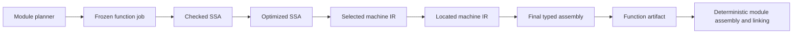

# A reproducible, independently checkable compiler backend in Lean 4

Status: research and design rationale, originally updated 2026-10-18; status
clarified 2026-10-24. See the [long-term core architecture proposal](long-term-core-architecture.md)
for the subsequent multiple-input discussion, reuse experiments and Claude review.
The roadmap currently prioritizes compatibility with a bounded focused-proof
allocation; broader certification is a separate gate. Detailed interfaces
and algorithms below remain proposals until implemented and qualified. The backend
is implemented in Lean 4 and accepts a general-purpose IR; it is not specifically
a compiler for Lean programs.

## Relationship to the current QBE port

The implementation plan is [ROADMAP.md](../../ROADMAP.md); current coverage is
[PORT_STATUS.md](../PORT_STATUS.md), and existing assurance boundaries are in
[DESIGN.md](../DESIGN.md). This document preserves the broader research so
architecture decisions can be made deliberately while the port progresses.
It is not an instruction to expand scope to MLIR integration, a JIT or a
custom linker before completing the QBE baseline.

Primary-source findings, proposed designs and the limits of the community
evidence review are distinguished below. The initial Claude invocation failed;
a subsequent read-only architecture review completed on 2026-10-23. Its findings,
limitations, and recommendations we did not adopt verbatim are recorded in the
[new research proposal](long-term-core-architecture.md#7-independent-claude-review-and-unresolved-findings).

## Product priorities and long-term direction

Correctness is the highest priority. Compilation speed, generated-code speed,
code size and implementation convenience are subordinate to a precise semantic
contract and justified preservation of that contract. Within the certified domain,
an optimization must have an applicable preservation proof or pass a sound,
proved validator before it is accepted. Outside that domain, report the path as
tested but uncertified; do not silently weaken a requested certification level.
Validation failure must produce an explicit error or use a separately justified
baseline path, never silently accept the rejected result.

The current work remains a QBE port in Lean 4. QBE is an implementation baseline,
a source of practical ABI experience and a differential test oracle. Permanent
QBE compatibility is not a long-term product requirement. After the baseline,
the internal IR, semantics and optimization pipeline may evolve where that
improves correctness or other measured goals. Preserve a QBE import boundary
where useful, with an explicit supported domain and semantic translation contract.
Future deviations should be versioned and documented rather than disguised as
compatibility. This direction does not change the current full-port milestone.

The ambition is to compete with established backends, with correctness as the
first differentiator. Compare the exact scope of guarantees: source semantics,
supported operations and targets, pass preservation, external-call assumptions,
machine encoding and linking coverage, and the remaining trusted computing base.
Count proved behavior and covered boundaries, not theorem count or lines of Lean.
CompCert and CakeML are especially important standards of comparison; no claim
of stronger assurance is justified without matching the scope of their results.

Within a fixed correctness contract, measure secondary goals using pinned
versions, identical workloads and explicit target/optimization settings:

- Repeatability and isolation: identical function artifacts under unrelated edits,
  different worker schedules and cold or warm caches.
- Compilation and incremental rebuilding: wall time, peak memory, checker time
  and the amount of work invalidated by representative edits.
- Generated programs: runtime and code size, with distributions and regressions
  across a representative suite rather than a single favorable benchmark.
- Engineering cost: effort to add an operation, ABI feature or target together
  with its semantics, validation and required preservation argument.

There is no established evidence that this backend currently beats these projects.
Set numerical performance targets after obtaining a repeatable baseline. Release
claims must distinguish tested compatibility, certified subsets and end-to-end
coverage, regardless of favorable performance results.

## Recommendation

Keep full QBE 1.3 compatibility as the first complete product milestone. Establish
function isolation, explicit semantics, typed lowering boundaries and reproducible
artifacts while completing that port. These foundations are expensive to retrofit.
Grow proofs alongside the implementation, with an explicitly limited certified
subset until the remaining paths are covered.

The central interfaces should be pure operations:

```lean
-- Architectural sketch, not a declaration of existing repository APIs.
compileFunction : FunctionJob → Except CompileError FunctionArtifact
verifyFunction :
  FunctionJob → FunctionArtifact → Except ValidationError CheckedArtifact
```

Filesystem access, scheduling, cache lookup and external tools belong in the
driver. `CheckedArtifact` must record precisely which properties were established.
Initially that may mean structural validity and artifact consistency; semantic
certification requires the relevant proved checker or proof evidence. A successful
verification result must never imply broader coverage than the checker provides.

A job includes every input that can influence its result. A function artifact
contains symbolic references rather than final addresses. Module planning resolves
dependencies before compilation; deterministic assembly and linking resolve layout
afterward. This makes the same unit useful for parallel compilation, caching,
proofs, regression tests and debugging.

There is no credible basis for promising a universal 1,000× improvement. The
high-value improvement is making failures local, repeatable and checkable, while
avoiding repeated work. Compile-time and generated-code gains must be measured.

## What to borrow

The observations below describe upstream ideas; the final column is our proposal.
They are not claims that upstream projects already provide our complete contract.

| Project | Relevant evidence | Adopt or adapt |
|---|---|---|
| QBE | A compact backend with a small SSA language and practical C ABI support. [Project and IL](https://c9x.me/compile/) | Preserve its manageable scope, compatibility corpus and baseline implementation. Use it as a differential oracle on defined inputs. |
| CompCert | Explicit intermediate semantics, simulation proofs, separate compilation, and validation of allocation results. [Documentation](https://compcert.org/doc/index.html) | Make semantic contracts and composition the architecture's organizing principle. Prove small transformations; use proved validators for suitable complex heuristics. |
| CompCertSSA | A verified SSA middle end, including construction and destruction. [Project](https://compcertssa.gitlabpages.inria.fr/) | Study the proof obligations for SSA transitions and dominance instead of assuming SSA makes proofs automatic. |
| Cranelift | Machine IR, declarative ISLE lowering and an external register allocator. [ISLE](https://github.com/bytecodealliance/wasmtime/tree/main/cranelift/isle), [machine backend](https://github.com/bytecodealliance/wasmtime/blob/main/cranelift/codegen/src/machinst/mod.rs) | Explicit target constraints and small inspectable lowering rules. Use symbolic allocation checking as inspiration, then prove our checker's soundness. |
| Zig | Function code generation and target-specific MIR are visible in the pinned source. [Official source distributions](https://ziglang.org/download/index.json) | A function produces its own code and relocation data. Strengthen the boundary to an immutable dependency snapshot; Zig's organization alone is not evidence of hermetic or bit-identical compilation. |
| MLIR | Isolated operations, scoped passes, legality-driven conversion, interfaces, block arguments and reproducers. [Pass management](https://mlir.llvm.org/docs/PassManagement/) | Borrow these contracts in a small Lean implementation. Avoid making a general dialect framework a prerequisite for the port. |
| LLVM | Explicit machine IR fixtures and target legalization. [MIR](https://llvm.org/docs/MIRLangRef.html), [GlobalISel legality](https://llvm.org/docs/GlobalISel/Legalizer.html) | Serialize intermediate stages and test individual passes. Make unsupported target operations explicit. |
| MIR, by Vladimir Makarov | A lightweight IR, interpreter and JIT pipeline. [Repository](https://github.com/vnmakarov/mir) | Keep an executable semantic reference and an inexpensive baseline lowering. A JIT is a separate future product decision. This is distinct from LLVM MIR and Rust MIR. |
| IR, by Dmitry Stogov | Graph-based JIT infrastructure and declarative folding rules. [Repository](https://github.com/dstogov/ir) | A compact rule library with explicit conditions. Adopting a sea-of-nodes representation is not necessary to obtain that benefit. |
| libFirm | Graph-based SSA, analyses, optimizations and graph inspection. [Features](https://libfirm.github.io/Features.html) | Strong invariant checks and useful stage dumps. Evaluate individual analyses rather than inheriting the entire graph architecture. |
| CakeML | A verified compiler extending to concrete machine code. [Project](https://cakeml.org/) | Use its end-to-end scope as a reference for eventually closing the encoding gap. An assembly-level theorem does not cover emitted bytes. |
| Alive2 | Translation validation for LLVM transformations. [Repository](https://github.com/AliveToolkit/alive2) | Check transformations at precise boundaries. It cannot directly validate our custom IR or native output. |
| lean-mlir | Lean infrastructure for SSA and verified rewrites. [Repository](https://github.com/opencompl/lean-mlir) | Run a bounded reuse experiment before choosing a dependency: one arithmetic rewrite, one conditional rewrite and a representative control-flow example. |
| Sail | Executable ISA specifications, including RISC-V. [RISC-V model](https://github.com/riscv/sail-riscv) | Evaluate a target-semantics connection for RV64 later. It does not automatically establish the AArch64 implementation's correctness. |
| TB/Cuik | A separate Tilde backend in an early compiler project. [Repository](https://github.com/RealNeGate/Cuik) | Study compact representations and phase costs; require local measurements before adopting performance claims. |

The original size comparisons used different source scopes and excluded different
dependencies. They should not decide architecture. Record pinned revisions and a
uniform counting methodology before presenting a fresh size ranking.

## The function independence contract

`FunctionJob` should contain:

- Validated function IR and a stable symbol identity.
- Target architecture, explicitly selected CPU features, ABI, data layout and
  relocation/code model.
- The exact imported declarations and semantic contracts the function uses:
  signatures, layouts, symbol linkage, runtime helpers and relevant constants.
- Compilation options, a versioned pass recipe and compiler identity.
- Any optional inline bodies, specialization facts or profile inputs actually
  consumed by this compilation.

All references must be resolved before entering the worker. Workers cannot look
up arbitrary module state. An imported function's implementation changing does
not invalidate callers unless they consumed its body or a derived fact. Its ABI
changing does invalidate them. Recursive calls use stable declaration identities;
they do not require recursively hashing every callee body.

Use local dense IDs internally and stable names at boundaries. Module insertion
order, pointer addresses, global fresh-name counters, hash-table iteration,
worker scheduling, host CPU detection, working directory, clock and random state
must not influence code generation. Local mutation inside a pure Lean interface
is compatible with this design; uncontrolled ambient inputs are the problem.

The acceptance criterion is stronger than rebuilding a whole program twice:
changing an unrelated function must leave this function's canonical code
fragment byte-for-byte unchanged when its code dependencies are unchanged. The
complete artifact also depends on debug/source metadata and evidence; their
separate dependency contracts are specified below.

Define a versioned canonical serialization with specified ordering and integer
encoding. Do not hash `Repr` output. A digest indexes a cache; it is not a proof
that two inputs are equal. Validate cached records and bind any correctness
evidence to the actual input and output. Separate job, code and evidence identities
so an unrelated proof packaging change need not alter generated code.

An artifact initially contains typed assembly, local labels, symbolic relocations,
owned constants, alignment, frame information, imports and source mappings.
Later it can contain bytes. Compilation independence means independence of that
artifact: final addresses and linked bytes can change when other functions move.
The reproducible final-build contract additionally requires a deterministic
assembler/linker and normalized metadata. Debug paths need an explicit mapping.

Do not promise history-independent release binaries from a linker that preserves
holes or prior placement for fast incremental updates. A deterministic release
layout can be a separate mode. Constant pooling and identical-code folding must
also respect observable address identity.

## A small set of typed stages



Use closed Lean datatypes, arrays and dense indices, with extrinsic well-formedness
predicates and checked constructors. Avoid requiring large dependent proofs in
every ordinary IR manipulation. Maintain a clear mathematical interpretation of
the efficient representation.

| Stage | Required boundary invariant |
|---|---|
| Checked SSA | Types, dominance, terminators and edge arguments are valid; imported references are resolved. |
| Optimized SSA | The same structural invariants, plus justified transformation conditions. |
| Selected machine IR | Legal instruction forms; virtual registers, fixed-register operands, clobbers, calling conventions and abstract stack slots are explicit. |
| Located machine IR | Physical locations and spill operations are assigned; edge copies preserve values; constraints and clobbers are respected. |
| Final typed assembly | Stack layout, alignment, prologue/epilogue and concrete offsets are resolved; unsupported pseudo-instructions are gone. |
| Artifact | Symbol references, local labels, relocations and metadata satisfy an explicit format contract. |

Keep the current stack-slot implementation as a baseline path while introducing
machine IR. This gives allocation work an independent comparison point. Translate
QBE phi nodes to internal block arguments at a checked boundary if that simplifies
the representation, and account for simultaneous edge assignments in the proof.

## MLIR ideas worth copying

**Pass isolation.** MLIR constrains passes from inspecting sibling operations and
using shared mutable state. Our function workers should go further: even readable
ancestor information must arrive in the frozen job. `IsolatedFromAbove` is not by
itself a complete dependency or reproducibility guarantee.
[Pass restrictions](https://mlir.llvm.org/docs/PassManagement/)

**Legality at every lowering boundary.** Each stage should specify what is legal
and reject residual unsupported operations. This resembles full dialect conversion,
rather than accepting a partially lowered program and hoping a later emitter
handles it. [Dialect conversion](https://mlir.llvm.org/docs/DialectConversion/)

**Effects and speculation are separate.** An operation that does not write memory
can still trap, diverge or otherwise be unsafe to speculate. Attach conservative
effect and speculation facts with semantic justification before enabling movement
or deletion. [Side effects and speculation](https://mlir.llvm.org/docs/Rationale/SideEffectsAndSpeculation/)

**Block arguments and operation descriptions.** Block arguments make incoming
values explicit at control-flow edges. Small declarative descriptions can generate
builders, printers, structural validators and instruction constraints. Keep the
semantic meaning independently auditable: generating an emitter and checker from
the same incorrect table does not establish ISA correctness.
[Blocks](https://mlir.llvm.org/docs/LangRef/#blocks),
[operation definitions](https://mlir.llvm.org/docs/DefiningDialects/Operations/)

**Reproducers and explicit pass recipes.** Serialize a failing function job, stage,
options and pass sequence. Analyses are tied to an IR revision and invalidated
unless their preservation is established. Treat correctness-critical analysis
results as proved conservative facts or validated certificates.

**Bounded rewriting.** Use deterministic priorities and work budgets. Correctness
must not depend on reaching a particular optimization normal form. Canonical
serialization is a separate requirement from MLIR-style canonicalization, which
is best effort. [Canonicalization](https://mlir.llvm.org/docs/Canonicalization/)

Defer a generic dialect plugin system, C++ MLIR dependency, tensor/polyhedral
passes, bufferization, GPU lowering and a general transform language until a
consumer demonstrates a need. A fixed, versioned pass recipe is sufficient now.

## CompCert should determine the correctness structure

Define source and target semantics before optimizing their translation. Use
small-step semantics for the specification, including machine-register aliases,
clobbers and stack accesses at the appropriate target stages. Use
fixed-width integers, explicit floating-point behavior, a specified memory model,
external-call events and precise treatment of traps, undefined behavior and
divergence. An interpreter with finite fuel is useful for testing; fuel exhaustion
is not a semantic account of divergence.
The interpreter should report execution-budget exhaustion as evaluation incomplete,
distinct from successful termination, a modeled trap or undefined behavior.

CompCert's block-and-offset memory model is a useful starting point, but adopting
it requires checking compatibility with QBE operations, ABI interactions and
pointer/integer conversions. C semantics cannot simply be substituted for QBE's
contract. [CompCert memory](https://compcert.org/doc/html/compcert.common.Memory.html)

Specify a simulation or refinement relation for each stage, including states,
memory and observable events. State precisely the assumptions under which defined
source behavior is preserved. Per-function theorems must quantify over compatible
external environments; composition must establish that the linked implementations
satisfy those contracts. Independent compilation alone does not prove safe linking.
[Compiler composition](https://compcert.org/doc/html/compcert.driver.Compiler.html),
[separate compilation](https://compcert.org/doc/html/compcert.common.Linking.html)

Direct proofs are attractive for local arithmetic rewrites, simple lowering and
frame transformations. For register allocation, permit an untrusted heuristic to
propose a result and require a proved checker to validate value flow through
moves, spills, reloads, joins and calls, as well as register aliases and constraints. Merely
checking that live ranges do not conflict is insufficient.
[CompCert allocation](https://compcert.org/doc/html/compcert.backend.Allocation.html),
[regalloc2's practical checker](https://github.com/bytecodealliance/regalloc2/blob/main/src/checker.rs)

Do not build a universal semantic-equivalence checker as a prerequisite. Choose
restricted transformations and certificate formats with tractable soundness
arguments. Offline SMT or synthesis tools may suggest rules; accept a rule only
with the required checked proof and side conditions. Solver scheduling should not
be a hidden input to ordinary production compilation.

Report verification scope explicitly:

- Structural validation establishes well-formedness, not semantic preservation.
- Determinism establishes repeatability, not correctness.
- A pass theorem must cover the implementation and input domain actually used.
- An assembly theorem leaves rendering, assembly, relocation and linking gaps.
- Native execution of a proved checker introduces a different trust boundary from
  replaying the relevant proof in the Lean kernel.

Record covered stages and assumptions with evidence tied to the precise artifact.
A self-reported receipt is not a proof. Audit axioms, `sorry`, unsafe execution and
external dependencies. Keep assemblers and linkers named in the trusted boundary
until their contributions are covered. Decoding generated bytes independently is
useful testing but does not by itself prove instruction semantics.

## What the current implementation changes about sequencing

The current implementation already has a pure `AArch64.emitFunction`, a
restricted integer/control-flow implementation, validation and an executable
interpreter. The current working tree also documents integer memory operations
and bounded entry-block stack allocations; see [DESIGN.md](../DESIGN.md) for the
authoritative scope. It emits assembly strings and assigns stack slots to
values. Its small selection theorem relates abstract arithmetic specifications; it does not
prove complete frame, control-flow, rendered-assembly or machine-byte behavior.

The roadmap now moves semantic contracts, function isolation, serialization and
typed lowering into F01–F05, with the first composed preservation result in C01–C03.
V01–V05 run alongside compatibility work rather than following the completed port.
The table below is a finer-grained design decomposition; the accepted milestone
identifiers and completion status are in [ROADMAP.md](../../ROADMAP.md). Adoption
of the sequence is not a claim that the foundations or proofs are implemented.

| Stage | Deliverable | Exit gate |
|---|---|---|
| 0 — Boundary and contracts | Frozen jobs, versioned canonical codecs, typed artifact skeleton, deterministic IDs, initial semantic contracts and lean-mlir reuse experiment. | The current subset produces identical code fragments alone, reordered and under different worker schedules; debug dependencies are checked separately. No undeclared dependency reads. |
| 1 — Typed baseline | Route existing integer/CFG stack lowering through typed machine IR and final assembly. | Regression parity; structural validators; a scoped preservation result covering edge copies, frame behavior and control flow in the chosen target model. |
| 2 — Memory and interfaces | Memory/data, symbols, calls, floating point, variadics and ABI contracts, expanding target coverage incrementally. | Defined-behavior differential tests and ABI fixtures pass; semantics and certification gaps are recorded per feature. |
| 3 — SSA and optimizations | QBE SSA construction, analyses and optimization behavior; effects and a small proved rewrite library. | Every enabled optimization has a documented contract, meaningful tests and explicit proof/validation status. |
| 4 — Allocation | Liveness, spills, constraints and allocation proposals with value-flow validation. | Adversarial fixtures exercise joins, calls and spills; checker soundness covers the certified subset; failures are explicit. |
| 5 — Complete compatible release | Finish inventoried QBE 1.3 syntax, passes, targets and ABI support. | Full upstream suite and coverage accounting, differential fuzzing, pinned performance measurements; tested and certified coverage are reported separately. |
| 6 — Incremental execution | Parallel workers and content-addressed cache over the established job boundary. | Cold/warm and scheduling matrices yield identical artifacts for identical complete inputs; code/debug dependencies invalidate separately; corrupt records are rejected. |
| 7 — Concrete encoding | Direct encoding and relocation/object support, beginning with the baseline target. | Encoding checks and target-semantics connection cover the claimed subset; assembler/linker assumptions remain explicit where applicable. |
| 8 — Composed certification | Open-function, lowering and artifact/linking results composed for a declared domain. | Exact supported-domain theorem and audited trust inventory; a standalone verification story for delivered artifacts. |
| 9 — Measured extensions | Consumer adapters, selected optimizations, richer debug information and optional specialization. | Workload-specific benefits and preserved correctness/reproducibility contracts. |

These are acceptance milestones, not a strict serial schedule. Cache work can
start after stage 0 and a stable artifact format; encoding can start after typed
target lowering stabilizes. Composition planning starts immediately, with its
covered domain growing throughout. Full QBE compatibility remains the first
complete product release; narrower verified milestones may precede it.

In the updated roadmap, F01–F05 contain V01's initial semantic contracts and the
foundational portions of E01/E03. C01–C03 establish the first composed proof;
V02–V05 then grow alongside P05–P12. Broader optimization and consumer work remains
separate from the compatibility milestone.

## Qualification and measurement

Keep replayable test artifacts containing canonical input, target configuration,
compiler/toolchain identities, pass recipe, seed and observed mismatch. Add an
isolated pass runner and stage dump format before developing complex optimizations.

Proposed driver interfaces are:

```text
lcb replay function.job --stop-after allocation
lcb verify function.job function.artifact
```

A serialized job should suffice to reproduce compilation without the original
frontend, project directory or cache, using the identified compiler and target
configuration. Replay invokes the same pure pipeline as ordinary compilation;
verification reports its exact coverage and remaining trusted assumptions.

The reproducibility matrix should cover function order, unrelated edits, thread
count, scheduling, fresh process, cache state and normalized source paths. Test
that ABI/layout/inline-body changes invalidate relevant jobs while unrelated
implementation changes do not. Distinguish deterministic errors from operational
failures such as out-of-memory termination.

Compare the interpreter, baseline lowering, optimized lowering, pinned QBE and
independent reference implementations on their common defined domain. Exercise
ABI behavior with native fixtures. Mutation tests should demonstrate that checkers
reject broken edge copies, clobbers, spills, frame offsets and evidence bindings.
Tests support engineering confidence; they do not replace universal proofs.

Measure compile time, peak memory, validation time, generated-code size, execution
time and the fraction of work reused after representative edits. Publish workload,
hardware, flags, toolchain and uncertainty. Keep runtime helpers explicit: writing
the compiler in Lean does not imply linking Lean's runtime into generated programs.

## Community discussion research

The [community evidence review](community-discussions.md) records the Reddit,
Lobsters and Hacker News material examined, primary-source checks, corrections,
coverage limits and design consequences. It replaces the earlier unverified
reading list. Some project/platform combinations yielded sparse results; those
gaps are explicit rather than presented as completed coverage.

The most consequential findings are the need to distinguish code and debug
dependencies, make specification and tool-boundary testing permanent, keep
integration and inspection usable, and avoid deriving architectural decisions
from incomparable performance anecdotes. The following decisions incorporate
those findings while preserving correctness as the first priority.

## Design decisions strengthened by the discussion review

The [community evidence review](community-discussions.md) supports the following
proposals. These are design choices for this backend, not claims that any one
upstream project already implements the whole design.

### A small verified core with replaceable search strategies

Keep the trusted semantic definitions, pass interfaces and sound checkers small.
Let instruction selection, allocation and optimization heuristics propose results
within narrowly specified validation domains. This permits algorithm changes
without weakening the acceptance rule. It does not make arbitrary transformations
cheap to validate: select certificate formats for specific transformations first.

All production modes should target the same source semantics. A fast baseline
and a more optimizing pipeline may differ in cost and accepted feature coverage,
but neither may silently change the meaning of an operation. Certification requests
must fail explicitly if a required stage lacks evidence. A separate experimental
mode must identify uncertified paths rather than masquerading as certified output.

Distinguish conditional soundness from successful compilation. Measure rejection
rates on the supported domain, checker resource usage and compilation termination.
For bounded algorithms, prove termination where practical; resource exhaustion
remains an explicit operational outcome, not evidence about the source program.

### Freeze semantic decisions before adding optimization permissions

Maintain a semantic decision ledger. Each entry has the chosen behavior, admitted
domain, examples and counterexamples, target obligations, and transformations it
permits. This makes disagreements reviewable before they become optimizer bugs.

| Topic | Proposed initial policy | Required evidence or unresolved choice |
|---|---|---|
| Integer arithmetic | Distinct wrapping, checked and explicitly preconditioned operations; QBE import preserves QBE's admitted behavior. | Prove width conversions, overflow conditions and lowering; never replace a checked operation with wrapping arithmetic silently. |
| Division and shifts | State exceptional inputs and shift-count treatment in each operation's semantics. | Model QBE compatibility separately from any future total/trapping operations. |
| Memory | Explicit lifetime, initialization, byte order, alignment and access-width rules; conservative alias reasoning. | Decide pointer provenance and pointer/integer round trips before enabling transformations depending on them. |
| Floating point | Begin with an explicit strict profile; no default reassociation or contraction. | Specify NaNs, signed zero, subnormals, rounding and exception-state assumptions per target. Unsupported profiles are rejected. |
| Calls | Conservative effects unless backed by a declared and justified contract. | Explain callbacks, reentrancy, retained pointers, clobbers, varargs and aggregate classification. |
| Traps and divergence | Preserve the chosen observable behavior; do not infer speculation safety from absence of memory writes. | Separate a modeled trap from host signals and resource exhaustion. |
| Concurrency | Initial certification explicitly sequential. | Atomic operations, fences, volatile/MMIO and concurrent contexts need distinct semantics and proofs; they cannot be treated as ordinary loads/stores. |
| Runtime integration | Explicit imports and capability declarations. | Tail calls, stack maps, GC safepoints, unwinding and nonlocal exits require defined contracts before support is advertised. |

LLVM's [UB manual](https://llvm.org/docs/UndefinedBehavior.html) illustrates why
optimizer permissions need precise definitions. Our proposed native IR should
avoid adding poison/undef machinery until a concrete use case and preservation
argument justify it. Defined trapping semantics and undefined source behavior
must never be conflated. Likewise, semantic preservation alone does not establish
constant-time execution, speculative-execution security or memory safety for an
unsafe source program; those require additional properties.

### Make ABI lowering its own checked boundary

Introduce a target-specific `AbiPlan` before machine instruction selection. It
records argument/result locations, extension rules, aggregate classification,
hidden parameters, stack alignment, caller/callee ownership and saved registers.
Instruction selection consumes that plan, and the resulting machine function is
checked against it. Include a plan version and relevant symbol contracts in the job.

This makes ABI bugs local and gives composition proofs a stable interface. Start
with the existing leaf calling convention, then add calls and aggregates. Test
against independently compiled callers and callees in both directions, including
register/stack boundaries and reentrant callbacks when supported.

### Use open-component correctness for function composition

Write function contracts over interactions, not only final return values. A
compatible callee may call back before returning, retain permitted memory, or
interact with shared globals. Define the memory relation across each call/return
and make environment assumptions explicit. Recursive components need a compositional
argument; a dependency DAG used for caching is not that argument.

[CompCertO](https://flint.cs.yale.edu/shao/papers/compcerto.html) specifically studies
compiled components and their interactions, including calling conventions. Study
it when designing our sequential call semantics. For later threaded contexts,
[CompCertOC](https://flint.cs.yale.edu/shao/papers/compcertoc.html) addresses shared
stack data and compositional compilation. These are research references, not
proofs that can be transplanted to our Lean implementation without reconstruction.

### Separate code, debug and evidence products

Define three dependency sets:

- Code dependencies: normalized semantic IR, target, ABI, pipeline and consumed
  optimization facts.
- Debug dependencies: source identities, normalized paths, line/column mappings
  and requested debug policy, bound to stable instruction origins.
- Evidence dependencies: semantic and theorem versions, checker identity and the
  exact inputs/outputs being justified.

An unrelated function edit must preserve the code fragment when code dependencies
do not change. If that edit shifts another function's source lines, its debug
artifact may change legitimately. The combined artifact is reproducible for the
same complete dependency set, not necessarily invariant under all source edits.
If a debug policy changes instruction selection, it becomes a code dependency.
Code and metadata must be re-associated correctly; separate hashing alone is
insufficient. This refines the stronger informal independence claim above.

### Treat cache and planner correctness as explicit obligations

Compilation may be pure while the driver supplies the wrong job. Validate that
the dependency snapshot matches resolved declarations and the requested target.
Content hashes accelerate lookup; they do not establish semantic validity. At the
cache boundary, check artifact format, input binding and required evidence before
use. Stale target/ABI schemas, substituted artifacts and truncated entries must
fail explicitly. A provenance manifest is useful even before a persistent cache.

Inlining and interprocedural analysis belong in an optional deterministic planner
that materializes all consumed bodies and facts before per-function compilation.
Facts such as “callee never writes memory” must invalidate when their justification
changes. Aggressive global optimization increases dependency fan-out; expose that
tradeoff rather than hiding it behind a function-level API. Compiler semantic
dependencies and debug dependencies need separate invalidation tests.

### Keep the target specification independent of heuristic code

Target descriptions can centralize operand types, register aliases, immediates,
clobbers and legality. A declarative selector chooses legal instructions; its
preservation argument connects those instructions to independently justified
target semantics. Rule coverage and overlap checks improve engineering confidence
but do not establish semantic correctness on their own.

For proof execution in Lean, distinguish kernel-replayed evidence from native
execution of a checker whose source is proved correct. Record the compiler/runtime
assumptions of the latter. Proof acceleration mechanisms must be audited rather
than treated as equivalent merely because the output carries a Lean theorem name.
Imported proofs from another prover require a justified translation or remain
external evidence.

### Make inspection and failure reduction part of the public product

Provide typed builders, a readable IR syntax, canonical job/artifact codecs,
stage-specific diagnostics, instruction-origin tracking and isolated pass fixtures.
An “explain” facility should show a rule, its side conditions, relevant target
constraints and evidence coverage. A reducer should retain well-formedness and
the failing semantic condition, not merely shorten text into an invalid program.

Collect client programs with different CFG, memory and calling patterns. Keep
independent reference evaluators even where compiler passes share semantic helpers:
agreement between two users of one faulty helper is weak evidence. Original and
corrected upstream-oracle results must remain distinguishable, as already described
in [the QBE discrepancy record](../UPSTREAM_DISCREPANCIES.md).

### Choose the next milestone by proof coverage

The strongest next research milestone is a narrow vertical slice: one fixed target
and ABI, checked integer CFG input, stack lowering, control-flow/phi/frame semantics,
typed assembly and a composed preservation statement with named remaining gaps.
Use that slice to settle representations before scaling the feature set. It should
include a nontrivial loop and parallel edge transfers, not only leaf arithmetic.

Prepare four reviewable specifications before implementing broader infrastructure:

1. Semantic decision ledger and supported-domain statement, including the target
   state relation and external-environment assumptions.
2. `FunctionJob`, `AbiPlan`, artifact and certificate schemas, with exact dependency
   and versioning rules.
3. Pass obligation table: direct proof, proved validation, or explicitly uncertified,
   plus composition requirements and failure behavior.
4. Qualification matrix covering semantics, ABI, artifact binding, reproducibility,
   parser/importer behavior, adversarial certificates and independent machine tests.

The roadmap adopts this sequencing while the detailed designs remain proposals.
Architecture foundations and proof design start now; full compatibility work can
continue alongside them. After the QBE baseline, grow the native IR according to
the semantic ledger and evidence, rather than treating QBE behavior as a permanent
ceiling. The intended competitive advantage is transparent, independently checkable
compilation with predictable incremental behavior; performance is optimized within
that contract.

## Immediate implementation slice

Start with the existing integer subset: freeze a function job, serialize it,
introduce typed target instructions around the stack baseline, and prove one
complete restricted path through control flow and frame handling. Add replay and
reproducibility tests at that boundary. This is small enough to review and exposes
the interfaces that memory, calls and allocation will need before those features
make the design difficult to change.
